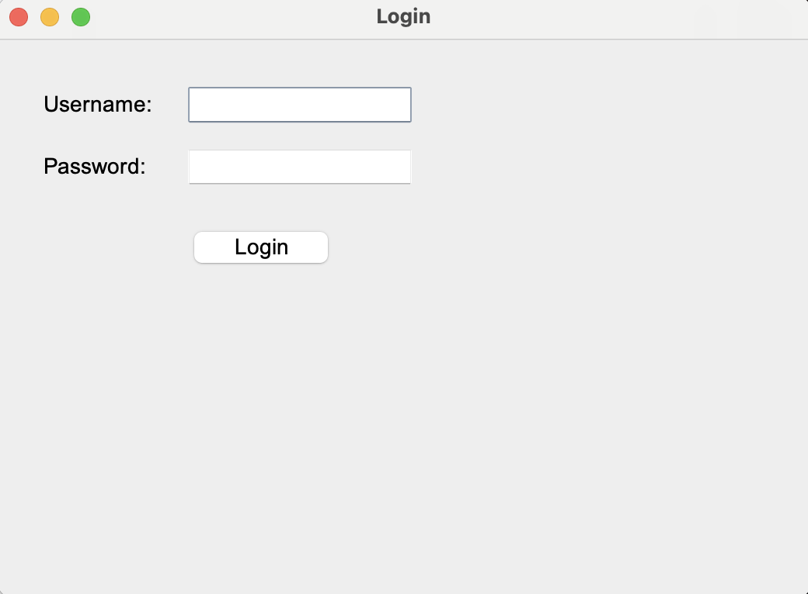
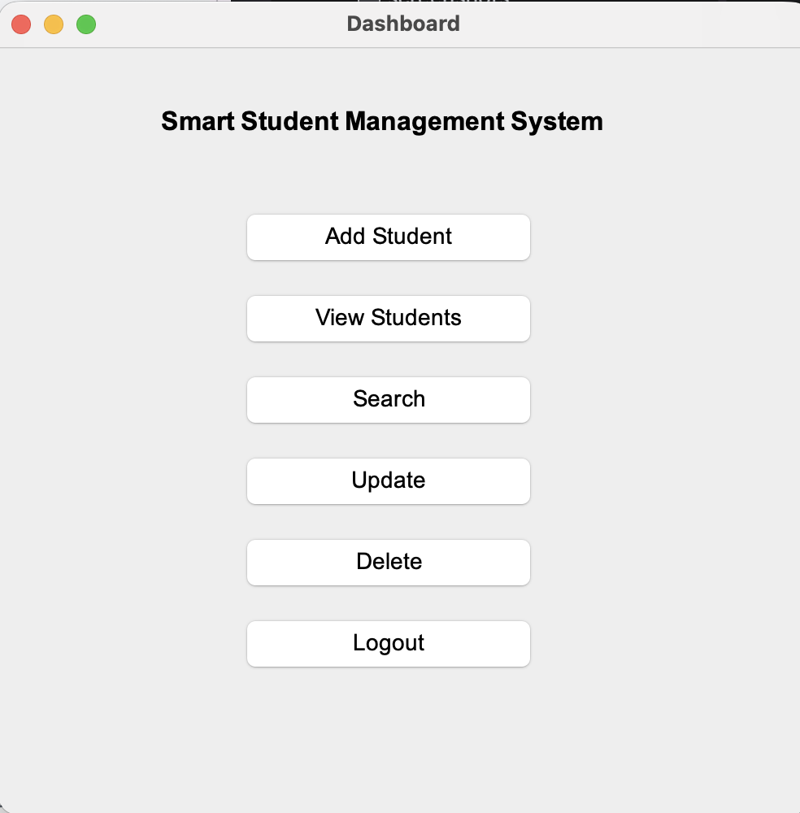
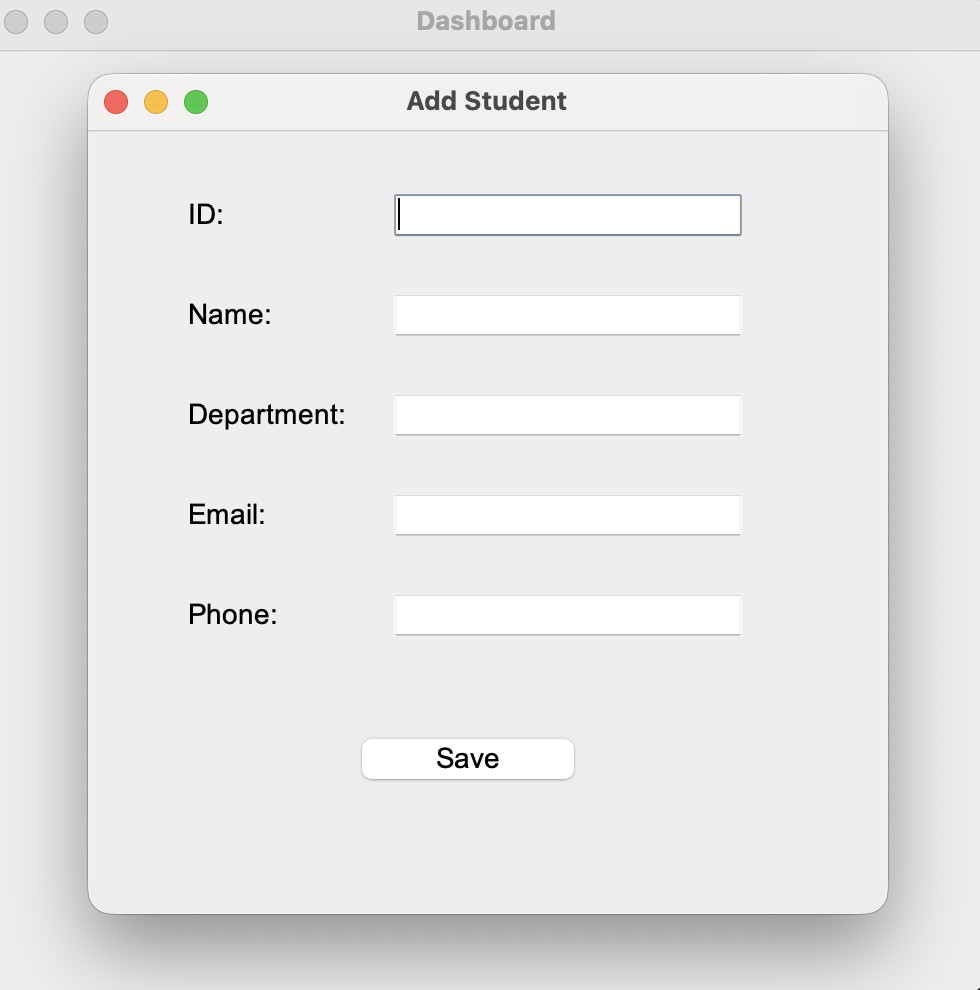
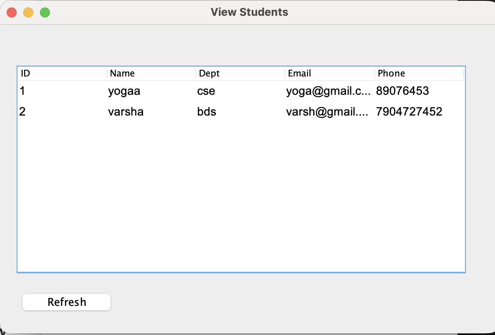
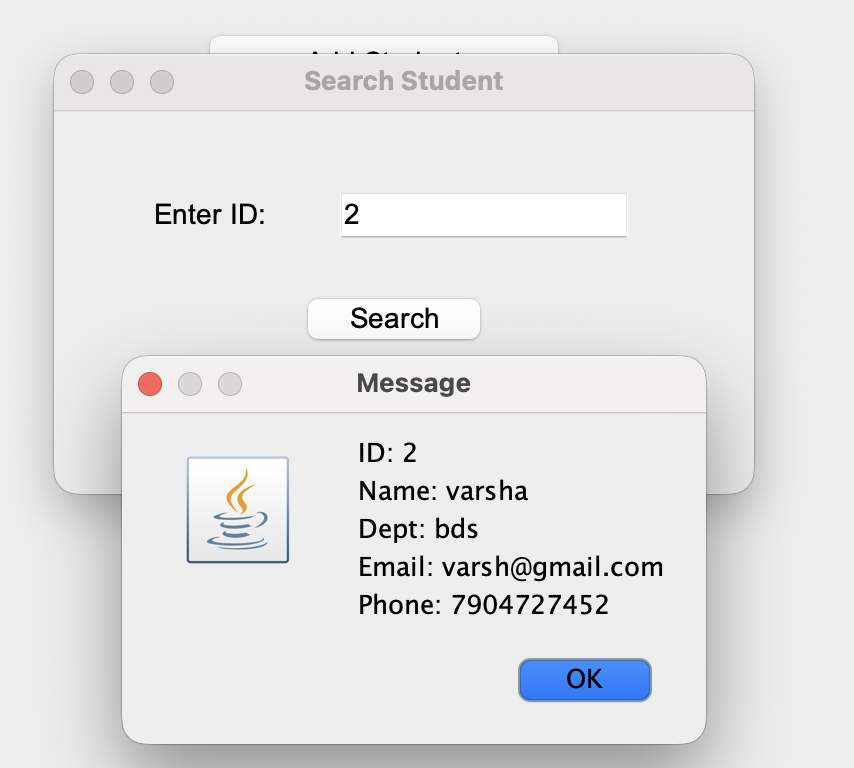
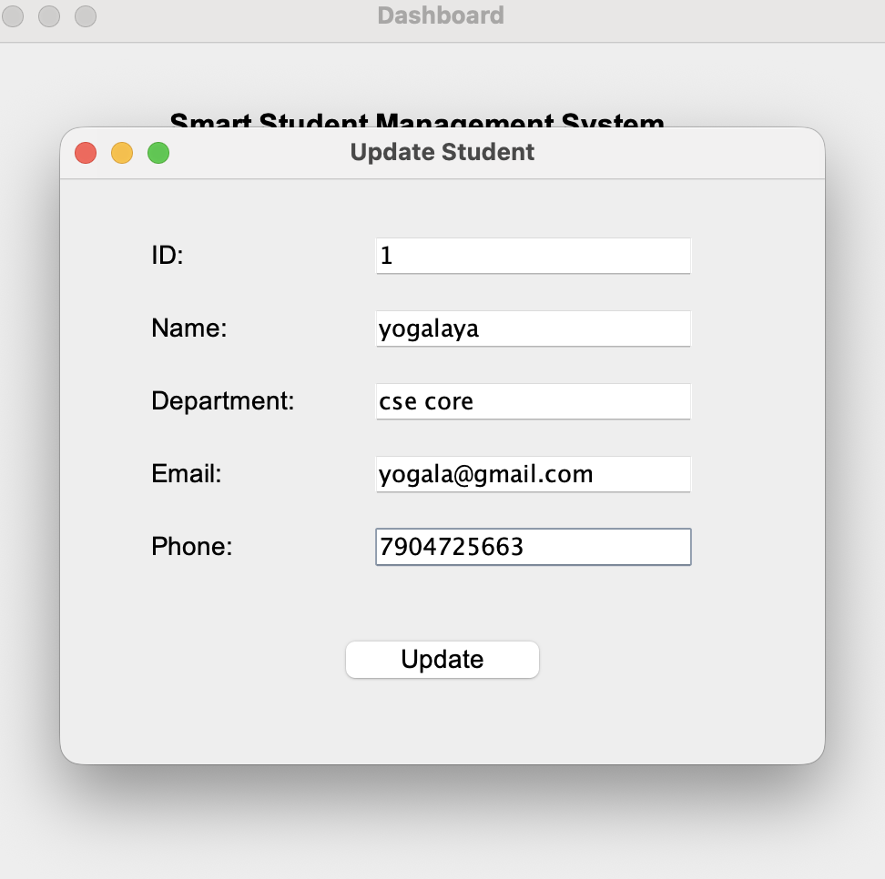
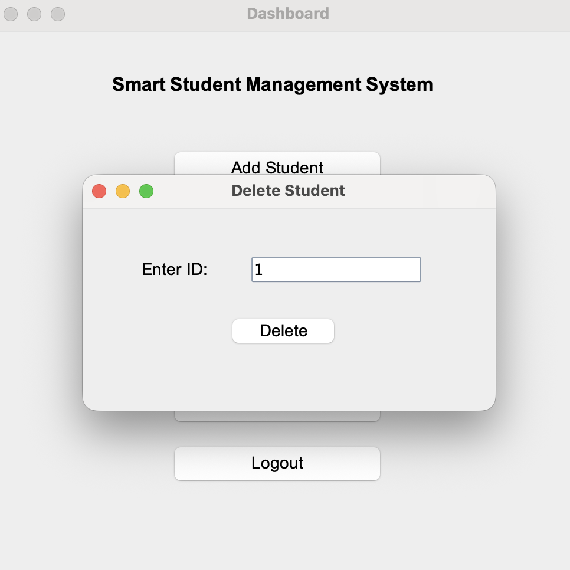

# Student Management System — Java Swing

A desktop application built with Java Swing to manage student records through a clean GUI. Demonstrates end-to-end software design using the Model–Service–UI architecture with file-based persistence — no external database required.

---

## Table of Contents

- [Overview](#overview)
- [Screenshots](#screenshots)
- [Features](#features)
- [Tech Stack](#tech-stack)
- [Architecture](#architecture)
- [Project Structure](#project-structure)
- [Getting Started](#getting-started)
- [Default Credentials](#default-credentials)
- [Data Persistence](#data-persistence)
- [Design Decisions](#design-decisions)
- [Future Roadmap](#future-roadmap)
- [Author](#author)

---

## Overview

This project simulates a real-world student record management workflow — from login authentication to full CRUD operations — built entirely with core Java. It was designed to practice layered architecture, GUI event handling, and file I/O without relying on frameworks or external libraries.

---

## Screenshots

### 🔐 Login Screen


### 🏠 Dashboard


### ➕ Add Student


### 📋 View All Students


### 🔍 Search Student


### ✏️ Update Student


### ❌ Delete Student


---

## Features

| Feature | Description |
|---|---|
| Authentication | Admin login with credential validation |
|Add Student | Register new students with ID, name, and details |
| View All | Display all records in a sortable JTable |
| Search | Look up a student by ID |
|  Update | Edit existing student details with immediate file sync |
|  Delete | Remove a record and persist changes instantly |
| Persistence | All data stored and loaded from a local flat file |

---

## Tech Stack

- **Language:** Java (JDK 8+)
- **GUI Framework:** Java Swing
- **Data Storage:** Flat file I/O (`BufferedReader` / `BufferedWriter`)
- **IDE:** IntelliJ IDEA
- **Paradigm:** Object-Oriented Programming — Encapsulation, Separation of Concerns, Single Responsibility

---

## Architecture

The project follows a **3-layer architecture** to keep concerns separated and code maintainable:

```
┌─────────────────────────────────┐
│           UI Layer              │  ← Java Swing frames (user interaction)
├─────────────────────────────────┤
│         Service Layer           │  ← Business logic (CRUD operations)
├─────────────────────────────────┤
│      Model + Storage Layer      │  ← Student POJO + FileStorage utility
└─────────────────────────────────┘
```

- **UI Layer** handles all user events via `ActionListener` and delegates to the service layer — it never touches the file system directly.
- **Service Layer** (`StudentService.java`) contains all business logic and acts as the single point of truth for data manipulation.
- **Storage Layer** (`FileStorage.java`) abstracts file read/write operations, making it straightforward to swap in a database later without touching any other layer.

---

## Project Structure

```
SmartStudentManager-Java/
├── src/
│   ├── model/
│   │   └── Student.java              # POJO with getters/setters (encapsulation)
│   ├── service/
│   │   └── StudentService.java       # CRUD logic, in-memory list management
│   ├── ui/
│   │   ├── LoginScreen.java          # Entry point, credential check
│   │   ├── DashboardFrame.java       # Navigation hub
│   │   ├── AddStudentFrame.java      # Form to register a new student
│   │   ├── ViewStudentsFrame.java    # JTable view of all records
│   │   ├── SearchStudentFrame.java   # Search by student ID
│   │   ├── UpdateStudentFrame.java   # Edit existing record
│   │   └── DeleteStudentFrame.java   # Delete by student ID
│   └── util/
│       └── FileStorage.java          # Handles read/write to students.txt
├── screenshots/
│   ├── login.png
│   ├── dashboard.png
│   ├── add-student.png
│   ├── view-students.png
│   ├── search-student.png
│   ├── update-student.png
│   └── delete-student.png
├── students.txt
└── README.md
```

---

## Getting Started

### Prerequisites

- Java JDK 8 or higher installed
- IntelliJ IDEA (or any Java IDE)

### Steps

```bash
# 1. Clone the repository
git clone https://github.com/yogalayaj2025-source/SmartStudentManager-Java.git

# 2. Open the project in IntelliJ IDEA
#    File → Open → select the project folder

# 3. Run the entry point
#    Navigate to src/ui/LoginScreen.java and run it
```

---

## Default Credentials

```
Username: admin
Password: admin123
```

> These are hardcoded for demo purposes. A production version would hash credentials and store them securely.

---

## Data Persistence

All student records are stored in a plain-text file:

```
students.txt
```

- The file is loaded into memory on application startup
- Every Add, Update, or Delete operation writes changes back to disk immediately
- No database setup or external dependencies required

---

## Design Decisions

**Why flat file storage instead of a database?**
The goal was to demonstrate file I/O and Java fundamentals without introducing JDBC or SQL complexity. The `FileStorage` utility is fully isolated so it can be replaced with a `DatabaseStorage` implementation without modifying any other class.

**Why separate frames for each operation?**
Each UI frame maps to a single responsibility. This keeps event-handling logic small and focused, and mirrors how real-world desktop applications separate workflows.

**Why no frameworks?**
Pure Java was chosen intentionally to demonstrate understanding of the language and standard library, which is a stronger foundation than framework familiarity at this stage.

---

## Future Roadmap

- [ ] Replace flat file with MySQL via JDBC
- [ ] Add student grades and marks module
- [ ] Implement role-based access (Admin / Viewer)
- [ ] Export records to PDF or Excel
- [ ] Migrate UI to JavaFX for a modern look
- [ ] Password hashing for secure authentication

---

## Author

**Yogalaya Jayakumar** 

Computer Science & Engineering | Student

[GitHub](https://github.com/your-username) · [LinkedIn](https://linkedin.com/in/your-profile)

---

> Built as a learning project to apply OOP principles, layered architecture, and Java Swing GUI development in a practical context.